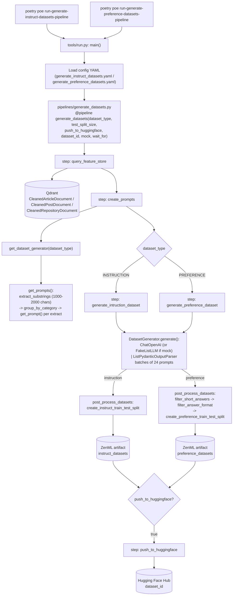

# `generate_datasets` Pipeline

Triggered by `poetry poe run-generate-instruct-datasets-pipeline` (SFT dataset) or `poetry poe run-generate-preference-datasets-pipeline` (DPO dataset). This is the pipeline that runs *after* `feature_engineering` — it reads the cleaned documents back out of Qdrant, asks an OpenAI-compatible LLM to turn them into training samples, splits them into train/test, and (optionally) pushes the result to the Hugging Face Hub, where the training pipeline picks it up.

## Pipeline task

There are two single, non-composite poe tasks, and both run the **same** pipeline function ([pyproject.toml:79-80](../pyproject.toml#L79-L80)):

```toml
run-generate-instruct-datasets-pipeline = "poetry run python -m tools.run --no-cache --run-generate-instruct-datasets"
run-generate-preference-datasets-pipeline = "poetry run python -m tools.run --no-cache --run-generate-preference-datasets"
```

- `--run-generate-instruct-datasets` — tells [main()](../tools/run.py#L113) to execute the `if run_generate_instruct_datasets:` branch ([tools/run.py:174-178](../tools/run.py#L174-L178)), which loads [configs/generate_instruct_datasets.yaml](../configs/generate_instruct_datasets.yaml)
- `--run-generate-preference-datasets` — executes the `if run_generate_preference_datasets:` branch ([tools/run.py:180-184](../tools/run.py#L180-L184)), which loads [configs/generate_preference_datasets.yaml](../configs/generate_preference_datasets.yaml)
- `--no-cache` — disables ZenML step caching for the run

The only thing that differs between the two tasks is the config file. The config's `dataset_type` parameter decides which branch the pipeline takes:

| Parameter | `generate_instruct_datasets.yaml` | `generate_preference_datasets.yaml` |
| --- | --- | --- |
| `dataset_type` | `instruction` | `preference` |
| `test_split_size` | `0.1` | `0.05` |
| `push_to_huggingface` | `true` | `true` |
| `dataset_id` | `mryoussef79/llmtwin` | `mryoussef79/llmtwin-dpo` |
| `mock` | `false` | `false` |

Set `mock: true` to swap the real LLM for LangChain's `FakeListLLM`, which returns a canned response. This lets you exercise the pipeline without an `OPENAI_API_KEY`. With `push_to_huggingface: true` you also need `HUGGINGFACE_ACCESS_TOKEN`, and `dataset_id` must point to a repo you can write to.

## Diagram



## Key read

Two things about this pipeline aren't obvious from the poe tasks:

1. **One pipeline produces two different datasets.** `generate_datasets` has an `if/elif` on `dataset_type` ([generate_datasets.py:18-23](../pipelines/generate_datasets.py#L18-L23)), so ZenML only builds the step for the branch that the config selects. Both branches use the same generator machinery. `get_dataset_generator()` returns either `InstructionDatasetGenerator` or `PreferenceDatasetGenerator`, and these subclasses only override the prompt template (pairs vs. `chosen`/`rejected` triples) and `post_process_datasets()`. The preference branch is the only one that drops samples after generation: it removes `chosen` answers that are shorter than 100 characters or that don't start with an uppercase letter and end with `.`, `!` or `?`.

2. **Unlike the earlier pipelines, the data *does* flow through ZenML.** `digital_data_etl` and `feature_engineering` write to MongoDB and Qdrant as side effects. Here, every step returns its data as a versioned ZenML artifact (`queried_cleaned_documents` → `prompts` → `instruct_datasets` / `preference_datasets`). The only external write is the optional push to the Hugging Face Hub. The next pipeline, `training`, reads the dataset from the Hub (or from the artifact), not from a database.

Also note that `query_feature_store` reads the **cleaned** Qdrant collections (the first `load_to_vector_db` call in `feature_engineering`), not the chunked and embedded ones. Its default `limit=1` means the scroll fetches one point per request until the offset runs out ([query_feature_store.py:67-75](../steps/generate_datasets/query_feature_store.py#L67-L75)). Prompts are also built from 1000–2000-character extracts rather than whole documents, and each extract is truncated to `OPENAI_MAX_TOKEN_WINDOW` tokens.

## Function call reference

| Diagram node | Function | Location |
| --- | --- | --- |
| `main()` | `main()` | [tools/run.py:113](../tools/run.py#L113) |
| instruct branch that builds and runs the pipeline | `if run_generate_instruct_datasets:` block | [tools/run.py:174-178](../tools/run.py#L174-L178) |
| preference branch that builds and runs the pipeline | `if run_generate_preference_datasets:` block | [tools/run.py:180-184](../tools/run.py#L180-L184) |
| `generate_datasets(...)` | `generate_datasets()` | [pipelines/generate_datasets.py:8](../pipelines/generate_datasets.py#L8) |
| `step: query_feature_store` | `query_feature_store()` | [steps/generate_datasets/query_feature_store.py:18](../steps/generate_datasets/query_feature_store.py#L18) |
| → parallel fetch of articles/posts/repos | `fetch_all_data()` | [query_feature_store.py:28](../steps/generate_datasets/query_feature_store.py#L28) |
| → paginated Qdrant scroll | `VectorBaseDocument.bulk_find()` | [llm_engineering/domain/base/vector.py:106](../llm_engineering/domain/base/vector.py#L106) |
| `step: create_prompts` | `create_prompts()` | [steps/generate_datasets/create_prompts.py:11](../steps/generate_datasets/create_prompts.py#L11) |
| `get_dataset_generator(dataset_type)` | `get_dataset_generator()` | [llm_engineering/application/dataset/generation.py:269](../llm_engineering/application/dataset/generation.py#L269) |
| → build prompts grouped by category | `DatasetGenerator.get_prompts()` | [generation.py:63](../llm_engineering/application/dataset/generation.py#L63) |
| → split documents into 1000–2000 char extracts | `extract_substrings()` | [llm_engineering/application/dataset/utils.py:106](../llm_engineering/application/dataset/utils.py#L106) |
| → render template + truncate to token window | `DatasetGenerator.get_prompt()` | [generation.py:75](../llm_engineering/application/dataset/generation.py#L75) |
| `step: generate_intruction_dataset` | `generate_intruction_dataset()` | [steps/generate_datasets/generate_intruction_dataset.py:13](../steps/generate_datasets/generate_intruction_dataset.py#L13) |
| `step: generate_preference_dataset` | `generate_preference_dataset()` | [steps/generate_datasets/generate_preference_dataset.py:13](../steps/generate_datasets/generate_preference_dataset.py#L13) |
| `DatasetGenerator.generate()` (LLM call + parse) | `DatasetGenerator.generate()` | [generation.py:105](../llm_engineering/application/dataset/generation.py#L105) |
| instruct prompt template + post-processing | `InstructionDatasetGenerator` | [generation.py:182](../llm_engineering/application/dataset/generation.py#L182) |
| preference prompt template + post-processing | `PreferenceDatasetGenerator` | [generation.py:220](../llm_engineering/application/dataset/generation.py#L220) |
| → instruct train/test split | `create_instruct_train_test_split()` | [utils.py:16](../llm_engineering/application/dataset/utils.py#L16) |
| → preference train/test split | `create_preference_train_test_split()` | [utils.py:45](../llm_engineering/application/dataset/utils.py#L45) |
| → drop `chosen` answers < 100 chars | `filter_short_answers()` | [utils.py:74](../llm_engineering/application/dataset/utils.py#L74) |
| → drop badly formatted `chosen` answers | `filter_answer_format()` | [utils.py:90](../llm_engineering/application/dataset/utils.py#L90) |
| `step: push_to_huggingface` | `push_to_huggingface()` | [steps/generate_datasets/push_to_huggingface.py:10](../steps/generate_datasets/push_to_huggingface.py#L10) |
| → convert split to a HF `DatasetDict` | `TrainTestSplit.to_huggingface()` | [llm_engineering/domain/dataset.py:61](../llm_engineering/domain/dataset.py#L61) |

## Relevant files

- [pyproject.toml](../pyproject.toml) — `run-generate-instruct-datasets-pipeline` / `run-generate-preference-datasets-pipeline` poe task definitions
- [tools/run.py](../tools/run.py) — CLI entry point
- [configs/generate_instruct_datasets.yaml](../configs/generate_instruct_datasets.yaml) — instruct pipeline parameters
- [configs/generate_preference_datasets.yaml](../configs/generate_preference_datasets.yaml) — preference pipeline parameters
- [pipelines/generate_datasets.py](../pipelines/generate_datasets.py) — ZenML pipeline definition
- [steps/generate_datasets/query_feature_store.py](../steps/generate_datasets/query_feature_store.py)
- [steps/generate_datasets/create_prompts.py](../steps/generate_datasets/create_prompts.py)
- [steps/generate_datasets/generate_intruction_dataset.py](../steps/generate_datasets/generate_intruction_dataset.py)
- [steps/generate_datasets/generate_preference_dataset.py](../steps/generate_datasets/generate_preference_dataset.py)
- [steps/generate_datasets/push_to_huggingface.py](../steps/generate_datasets/push_to_huggingface.py)
- [llm_engineering/application/dataset/generation.py](../llm_engineering/application/dataset/generation.py) — `DatasetGenerator` and its instruct/preference subclasses (prompt templates, LLM chain)
- [llm_engineering/application/dataset/utils.py](../llm_engineering/application/dataset/utils.py) — extract splitting, filtering, and train/test split helpers
- [llm_engineering/domain/dataset.py](../llm_engineering/domain/dataset.py) — dataset/sample domain models and `to_huggingface()`
